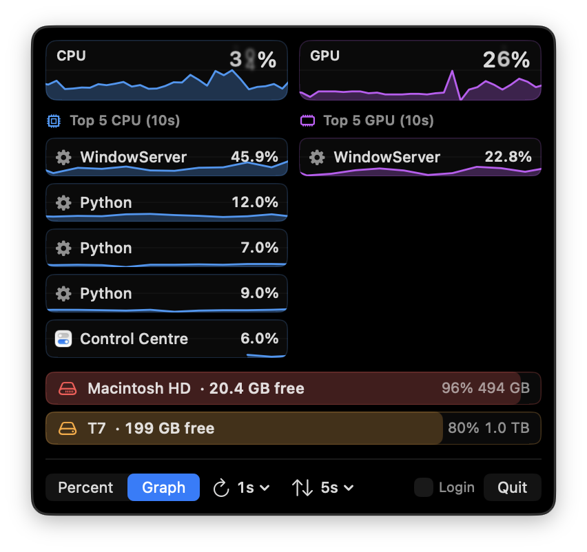

# MenuBarStats

MenuBarStats is a native macOS menu bar app for checking CPU, GPU, and startup disk usage. Click its menu bar item to see which processes are using the most CPU and GPU.



## Features

- Show system-wide CPU and GPU usage as percentages or live graphs. A pie indicator shows startup disk usage in both modes.
- View the five busiest processes for CPU and GPU, with recent history in Graph mode.
- Set how often readings refresh and how often the process lists reorder. Each interval can be set to 1, 2, 3, 5, or 10 seconds.
- Enable launch at login from the popover. Display and refresh settings are saved locally.

Percent mode collects per-process readings while the popover is open. Graph mode also collects them in the background so recent history is available when you open it. System readings are collected locally using macOS APIs.

## Build from source

You'll need macOS 14 or later, Xcode, and XcodeGen. GPU metrics depend on the counters available on your Mac. The app has been tested on Apple silicon.

If you use Homebrew, install XcodeGen with `brew install xcodegen`. From the repository root, run the build script and open the resulting app.

```bash
./scripts/build.sh
open MenuBarStats.app
```

The script generates the Xcode project from `project.yml` and places the Release build at `MenuBarStats.app`. The default build uses local ad-hoc signing, so an Apple Developer account is optional for building and running the app on your Mac.

## Run the tests

After building, run the unit tests, application self-test, and signature check.

```bash
./scripts/test.sh
```
